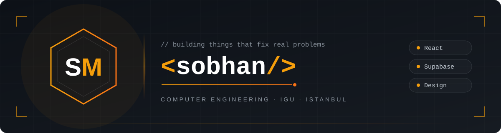

<div align="center">

# ☕ Cafe Roll Digital Menu

### Scan the QR, see the whole menu. The café updates it themselves.


**🇮🇷 فارسی (right-to-left) · 🇬🇧 English names · ☕ Espresso dark theme · 📱 Mobile first**

### 🔗 [See the live menu](https://roll-digital-menu.netlify.app/)

</div>

---

## 💡 Why I built this

Cafe Roll needed a menu customers could open on their phones, just by tapping a link or scanning a QR code, with photos and up-to-date prices.

So I built the digital menu plus a small dashboard where the café can add products, change prices and mark things sold out by themselves, without touching any code. It's a real menu for a real café. 🚀

---

## 🎨 Design

**Dark, warm and coffee-inspired**, made to match the café's own branding.

- 🟤 Espresso-brown background with the café's red as the accent
- 🪟 Frosted glass cards on top of a coffee photo background
- 🔤 **Vazirmatn** for Persian and Latin text, hosted with the site
- ↔️ Full right-to-left layout for Persian
- 🌀 Animated category switching and product transitions
- ♿ Respects "reduce motion", keyboard friendly

---

## ✨ Features

### ☕ For customers
- 📱 Open the menu from a link or a QR code, no account needed
- 🖼️ Product names, descriptions, photos and prices in toman
- 🔎 Search by product name
- 🗂️ Filter by category with animated tabs
- 🚫 Sold-out items stay visible with an "unavailable" badge
- 💻 Works on phones and desktops

### 👨‍🍳 For the café owner
- 🔐 Email and password sign-in, plus sign-out
- ➕ Add, edit and delete products
- ✏️ Change name, description, price, category and photo
- 💡 Category suggestions from the categories you already use
- 🔁 Mark products available or unavailable
- 🖼️ Photos are resized to 960px and turned into WebP in the browser before upload
- 🧹 Old photos are deleted after they're replaced, if nothing else uses them
- 🔔 Toast messages and loading spinners for every action

---

## 🔒 Security

I treated security as a core feature, not an afterthought:

- 🛡️ **Row Level Security** on every table: anyone can read the menu, only admins can change it
- 👥 **Admin list in the database:** being logged in isn't enough, your account must be in `admin_users`
- 🚪 **No admin sign-up in the app:** admins are added only from the Supabase dashboard
- 🖼️ **Storage rules:** only admins can upload or delete product photos
- ✅ **Upload checks:** JPG, PNG or WebP only, max 2 MB
- 🔑 **Publishable key only** in the frontend; secret keys never touch the browser or GitHub
- 🔁 **Safe saves:** if a save fails after an upload, the unused photo is cleaned up, and unclear results ask you to refresh before trying again (no duplicate products)

---

## 🛠️ Tech stack

| | Technology |
|---|---|
| ⚛️ Frontend | React 19 + Vite 8 |
| 🧭 Routing | React Router 7 (menu, login, protected admin) |
| 🎨 Styling | Tailwind CSS 4 + shared theme CSS |
| 🌀 Animation | Motion |
| 🗄️ Database | PostgreSQL (Supabase) |
| 🔑 Auth | Supabase Auth (email + password) |
| 🖼️ Images | Supabase Storage |
| 🔔 UI feedback | react-hot-toast, react-spinners, Phosphor Icons |
| 🚀 Hosting | Netlify |

---

## 📁 Project structure

<details>
<summary>Click to expand</summary>

```
src/
├── main.jsx                     🚪 Entry point
├── index.css                    🪟 Shared styling, glass surfaces and font
├── theme.css                    ☕ Espresso theme and responsive layout
├── components/
│   ├── App.jsx                  🧭 Routes, product state and actions
│   ├── AddProductForm.jsx       ➕ Add/edit form and validation
│   ├── CafeLogo.jsx             ☕ Shared café branding
│   ├── CategoryTabs.jsx         🗂️ Animated category filtering
│   ├── Loading.jsx              ⏳ Loading indicators
│   ├── ProductCard.jsx          🃏 Customer card and admin controls
│   └── ProtectedRoute.jsx       🔐 Admin access checks
├── lib/
│   ├── adminAccess.js           👥 Auth and admin membership check
│   ├── optimizeProductImage.js  🖼️ Resizes photos and turns them into WebP
│   ├── productMedia.js          🧩 Image fallback and sample names
│   ├── productService.js        🔌 Reads, writes, uploads and cleanup
│   ├── productStore.js          🗃️ Old browser-storage helper (not used anymore)
│   ├── buildInfo.js             🏷️ Build info
│   └── supabaseClient.js        🔌 Supabase client
└── pages/
    ├── MenuPage.jsx             📋 The public menu
    ├── LoginPage.jsx            🔐 Admin sign-in
    └── AdminPage.jsx            👨‍🍳 Admin dashboard

public/
├── fonts/                       🔤 Vazirmatn
├── images/                      🖼️ Background and sample photos
└── _redirects                   🔁 Netlify routing for /login and /admin

assets/
└── banner1.svg                  🎨 README banner
```

</details>

---

## 🚀 Getting started

**1. Clone and install**
```bash
npm ci
```

**2. Add your environment variables**

Create `.env.local` next to `package.json`:
```dotenv
VITE_SUPABASE_URL=https://YOUR_PROJECT_REF.supabase.co
VITE_SUPABASE_PUBLISHABLE_KEY=YOUR_SUPABASE_PUBLISHABLE_KEY
```

> ⚠️ Use the **publishable** key only. Database passwords and secret / service-role keys never go in the frontend, and `.env.local` never goes on GitHub.

**3. Set up Supabase**

<details>
<summary>🗄️ Tables, security rules, photo bucket and admin account</summary>

The application expects the following tables, permissions and storage bucket. The SQL below is an initial setup for a **new Supabase project**. If your project is already configured, compare its schema and policies rather than rerunning the setup. This README does not contain a migration runner.

#### 1. Create the database tables

Run the following in the Supabase SQL Editor:

```sql
create table public.products (
  id uuid primary key default gen_random_uuid(),
  name text not null check (length(trim(name)) > 0),
  description text not null default '',
  price bigint not null check (price > 0),
  category text not null check (length(trim(category)) > 0),
  is_available boolean not null default true,
  image_url text not null check (length(trim(image_url)) > 0),
  image_path text,
  created_at timestamptz not null default now()
);

create table public.admin_users (
  user_id uuid primary key references auth.users(id) on delete cascade,
  created_at timestamptz not null default now()
);
```

`price` is a positive integer in toman. `image_url` is the public image URL; `image_path` is the Storage object path used for cleanup. Categories are stored as text on each product.

#### 2. Configure database access

The menu needs public read access. Product mutations require both a valid authenticated user and an administrator membership row. A protected React route controls the UI; database policies enforce access to the actual data. See [Supabase Row Level Security](https://supabase.com/docs/guides/database/postgres/row-level-security).

```sql
alter table public.products enable row level security;
alter table public.admin_users enable row level security;

revoke all on public.products from anon, authenticated;
revoke all on public.admin_users from anon, authenticated;

grant select on public.products to anon, authenticated;
grant insert, update, delete on public.products to authenticated;
grant select on public.admin_users to authenticated;

create policy "Users can read their own admin membership"
on public.admin_users
for select to authenticated
using (user_id = (select auth.uid()));

create policy "Anyone can read menu products"
on public.products
for select to anon, authenticated
using (true);

create policy "Administrators can manage products"
on public.products
for all to authenticated
using (
  exists (
    select 1 from public.admin_users
    where user_id = (select auth.uid())
  )
)
with check (
  exists (
    select 1 from public.admin_users
    where user_id = (select auth.uid())
  )
);
```

The app does not grant administrator membership through the browser. Manage membership from the Supabase dashboard or SQL Editor.

#### 3. Create the product image bucket

In Supabase Storage, create a bucket with these settings:

| Setting | Value |
| --- | --- |
| Bucket name and ID | `product-images` |
| Public bucket | Enabled |
| Maximum file size | `2097152` bytes (2 MiB) |
| Allowed MIME types | `image/jpeg`, `image/png`, `image/webp` |

Public access allows customers to display product images. Keep image mutations restricted to administrators. See [Supabase bucket configuration](https://supabase.com/docs/guides/storage/buckets/creating-buckets).

Add the Storage policy in the SQL Editor:

```sql
create policy "Administrators can manage product images"
on storage.objects
for all to authenticated
using (
  bucket_id = 'product-images'
  and exists (
    select 1 from public.admin_users
    where user_id = (select auth.uid())
  )
)
with check (
  bucket_id = 'product-images'
  and exists (
    select 1 from public.admin_users
    where user_id = (select auth.uid())
  )
);
```

#### 4. Add an administrator

1. Enable email/password authentication in Supabase Auth.
2. Create the administrator account in the Authentication dashboard.
3. Ensure that account can sign in under your email confirmation settings.
4. Copy its user UUID and insert it into `admin_users`:

```sql
insert into public.admin_users (user_id)
values ('REPLACE_WITH_AUTH_USER_UUID')
on conflict (user_id) do nothing;
```

Open `/login`, sign in with that account, and manage products at `/admin`.

An authenticated account without an `admin_users` row is denied administrator access. A signed-out visitor opening `/admin` is redirected to `/login`.

</details>

**4. Run it**
```bash
npm run dev
```

Then open the local link it prints, usually `http://localhost:5173`. The admin dashboard is at `/login` → `/admin`.

> 💡 Restart `npm run dev` after editing `.env.local`, and rebuild before publishing.

<details>
<summary>🚀 Deploy to Netlify</summary>

**Manual:** run `npm run build`, then upload the `dist` folder on your Netlify project's **Deploys** page.

**From GitHub:**

Connect the repository to the Netlify project and configure:

| Setting | Value |
| --- | --- |
| Build command | `npm run build` |
| Publish directory | `dist` |
| Runtime | Node.js 24 |
| Build environment variables | `VITE_SUPABASE_URL`, `VITE_SUPABASE_PUBLISHABLE_KEY` |

Set these variables in Netlify with the same values used locally. `.env.local` is ignored by Git and will not arrive through a repository deployment. Trigger a new build after changing the values. See [Netlify's Vite deployment guide](https://docs.netlify.com/build/frameworks/framework-setup-guides/vite/).

Keep `public/_redirects` with `/* /index.html 200` so refreshing `/login` or `/admin` works.

</details>

<details>
<summary>🧯 Troubleshooting</summary>

| Problem | What to check |
| --- | --- |
| Only the background appears | Open browser DevTools → Console and Network. Check runtime errors and failed JavaScript requests. Verify a fresh build, connection settings and complete deployment assets. |
| Missing Supabase configuration error | Check the two exact environment variable names, restart local development or rebuild the deployment. |
| “No products found” | Check whether `products` contains rows, the selected category, search text and public read policies. |
| Sign-in succeeds but access is denied | Check that the signed-in user's UUID exists in `admin_users` and that their membership row is readable. |
| Upload fails | Check file type, size, bucket ID, bucket settings, administrator membership and Storage policies. |
| Product writes fail | Check the database schema, authenticated session, grants and administrator policies. |
| Old favicon appears | Confirm the new icon file and HTML link were deployed; reopen the site in a new tab or private window. |
| Refreshing a nested route returns 404 | Confirm `_redirects` exists in the deployed folder. |
| Another browser shows old products | Refresh that menu; the current app does not subscribe to live database updates. |

For an ambiguous save error, refresh and inspect the product list before retrying, to avoid creating a duplicate product.

</details>

---

## 🗺️ Roadmap

### ✅ Done
- [x] 📋 Public menu with search and categories
- [x] ↔️ Persian right-to-left layout
- [x] 👨‍🍳 Admin dashboard: add, edit, delete, sold out
- [x] 🖼️ Photo upload with in-browser WebP optimization
- [x] 🛡️ Row Level Security and admin-only storage
- [x] 🎨 Redesign with glass cards and animations
- [x] 🚀 Live on Netlify

### 🚧 In progress
- [ ] 🧹 Small fixes and polish

### 📌 Planned
- [ ] 📡 Live menu updates without refreshing (Supabase Realtime)
- [ ] 🧹 Clean up old unused photos in the bucket

### 🔮 Future ideas
- [ ] 🌍 Full English version of the menu
- [ ] 🧾 Simple ordering from the table

---

## 📜 License

This project has its own license. **Please read [LICENSE.md](LICENSE.md) before using the code.**

- ✅ You can copy, change and use the code **if you credit me** or **get my permission**
- 🚫 You can't claim it as your own work
- ☕ The Cafe Roll name, logo and photos belong to the café, and the bundled Vazirmatn font keeps its own license

---

## 👨‍💻 About me

Hi, I'm **Sobhan Mirgholami**, a Computer Engineering student at **Istanbul Gelişim University**. I love programming, design, and solving real problems I see around me. This one is a real menu I built for Cafe Roll. ☕

[Portfolio](https://sobhan-cosmo.vercel.app) · [LinkedIn](https://www.linkedin.com/in/sobhan-mirgholami-a2093b417/) · [GitHub](https://github.com/SobhanMirgholami)

---

<div align="center">

Made with ☕ and late nights in Istanbul

⭐ If you like this project, give it a star!

</div>
